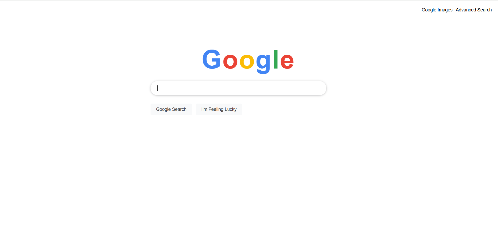
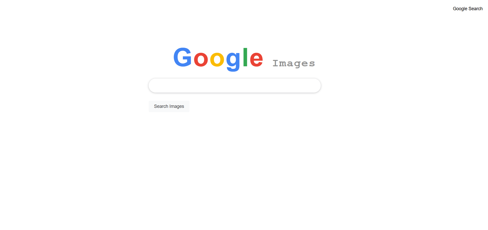
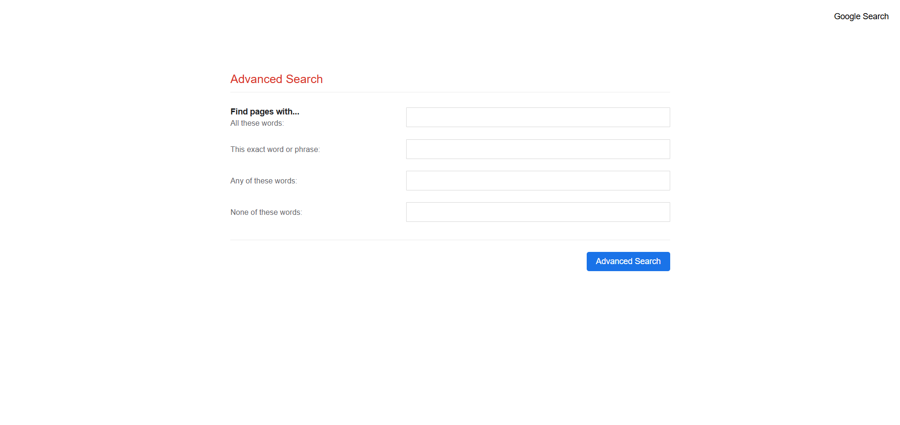

# 🔍 Google Search Front-End Clone

A clean, responsive front-end implementation of Google's Search interfaces—including Google Search, Google Image Search, and Google Advanced Search—built from scratch using semantic HTML5 and modern CSS3.

## ✨ Features
- **Google Search (index.html):** Standard search interface with centered layout, rounded search bar, and functional "Google Search" and "I'm Feeling Lucky" buttons that redirect directly to Google results.
- **Google Image Search (image.html):** Dedicated interface allowing users to query Google Images directly (tbm=isch).
- **Google Advanced Search (advanced.html):** Structured multi-field form supporting exact phrases, all words, any words, and excluded words (as_q, as_epq, as_oq, as_eq), styled to match Google's authentic layout.
- Seamless Navigation: Consistent top-right navigation links across all pages for effortless switching between search modes.

## 🛠️ Tech Stack
- HTML5: Semantic forms, query parameters, and structured page layouts.
- CSS3: Flexbox alignment, custom focus states, responsive containers, and clean typography.

## 📸 Screenshots

### Main Search Page

### Image Search Page

### Advanced Search Page

## 🚀 How to Run Locally
1. Clone this repository:
   `bash
   git clone [https://github.com/SomiaMSalah/google-search-clone.git](https://github.com/SomiaMSalah/google-search-clone.git)